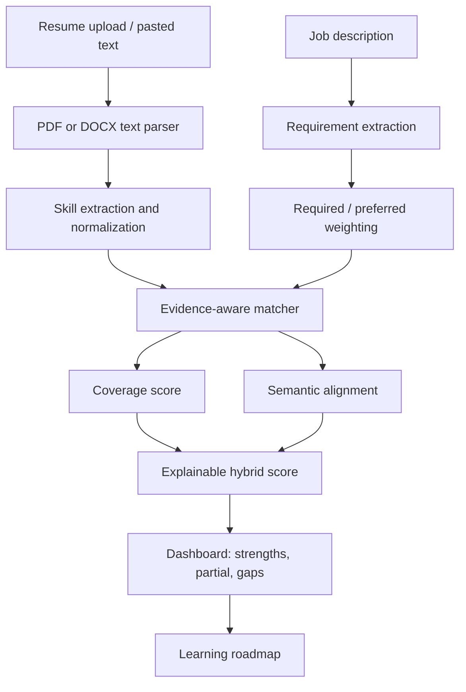

# Project Plan — Intelligent Resume–Job Matching & Explainable Skill Gap Analyzer

**Category:** CSE / AI / NLP / Full-stack development  
**Recommended duration:** 12-week semester execution plan (adjust to the department calendar)  
**Team size:** 2–3 students  
**Primary deliverable:** A working web application plus a documented comparative evaluation.

## 1. Problem and motivation

Students and early-career applicants often cannot tell which job requirements they already demonstrate and which gaps to address. Manual comparison is slow; exact keyword matchers can miss synonyms and can overstate a match when a keyword appears without meaningful evidence.

The project will build a tool that extracts skills from a resume and a job description, normalizes aliases, compares evidence with weighted requirements, provides a transparent score, and turns gaps into a prioritized learning plan.

## 2. Research question and gap

**Research question:** Does adding semantic similarity and evidence-aware explanations to normalized weighted skill coverage improve the quality and usefulness of resume–job matching compared with keyword-only matching?

**Project-level gap to investigate:** A score-only keyword matcher does not explain where a candidate demonstrated a skill, does not handle related wording consistently, and does not translate missing requirements into a practical next step. The project will test whether a hybrid method addresses these limitations on a small, manually annotated evaluation set.

This is a scoped student-project research gap, not a claim that no prior system has addressed these problems. The literature review must identify and compare existing resume parsers, skill extraction methods, embedding-based matching systems and explainable recommendation approaches.

## 3. Objectives

1. Extract technical skills, projects, education and experience evidence from PDF/DOCX resumes or pasted text.
2. Extract required and preferred skills from job descriptions where wording provides enough context.
3. Normalize common aliases (for example, JS → JavaScript).
4. Calculate an explainable score from weighted skill coverage and semantic alignment.
5. Categorize requirements as strong, partial, missing or uncertain (uncertainty handling can be added after the baseline).
6. Recommend prioritized learning tasks and project ideas for gaps.
7. Compare the proposed hybrid approach against a keyword-only baseline using manually annotated examples.

## 4. Scope and non-goals

### In scope

- Entry-level software engineering, backend, data analysis and ML internship roles.
- PDF/DOCX text extraction and pasted text.
- Curated taxonomy and synonym normalization.
- Required/preferred weighting.
- Evidence snippets and match explanations.
- Weighted coverage + semantic similarity.
- Learning roadmap and comparative evaluation.

### Deferred / future work

- OCR for scanned resumes.
- Authentication, saved history and multi-tenant controls.
- Job-board scraping or automated job applications.
- Larger occupation taxonomies and multilingual resumes.
- Portfolio/GitHub evidence, only with explicit user consent.
- Personalized recommendations from learner progress.

## 5. Proposed methodology

### Stage A — Data and document extraction

- Extract selectable text from PDF and DOCX files.
- Segment the content into lines/sentences and preserve short evidence snippets.
- Document file type, parsing failures and unsupported scanned files.

### Stage B — Skill extraction and normalization

- Build a versioned, curated skill taxonomy with canonical names, aliases and categories.
- Implement an exact/alias baseline with boundary-aware matching.
- Add NLP-assisted extraction (spaCy patterns or equivalent) after measuring baseline errors.
- Review false positives and false negatives against manual labels.

### Stage C — Job requirement weighting

- Detect skill mentions in job descriptions.
- Label skills as required by default; mark as preferred only when local context contains signals such as “preferred”, “nice to have”, “bonus” or “desirable”.
- Weight required skills 2 and preferred skills 1 for the initial experiment.
- Record uncertain classifications for manual review in the evaluation dataset.

### Stage D — Evidence-aware hybrid matching

For each job requirement, assign a match value:

- Strong: direct normalized evidence (`1.0`).
- Partial: related or sufficiently similar evidence (`0.5`).
- Missing: no evidence detected (`0.0`).

`Coverage Score = 100 × Σ(weight × match value) / Σ(weight)`

Initial hybrid score: `75% × Coverage Score + 25% × Semantic Similarity Score`. Semantic similarity is a supporting signal; it must not independently establish proficiency. Compare multiple thresholds and score weightings during evaluation.

### Stage E — Skill-gap roadmap

- Prioritize missing required skills first.
- Follow with partial matches that need stronger evidence or practice.
- Provide one learning task and one portfolio-sized project idea per skill.
- Keep recommendations traceable to the missing/partial job requirement.

### Stage F — Evaluation

Compare:

1. Keyword-only normalized baseline.
2. Hybrid system with evidence-aware weighted coverage and embeddings.

Use the same examples and split for both systems. Report precision, recall and F1 for skill detection/match classification; report score agreement against human ratings; and run an ablation without semantic similarity.

## 6. System architecture

### Proposed stack

| Layer | Technology | Purpose |
|---|---|---|
| Frontend | React + TypeScript + Vite | Resume/JD input and results dashboard |
| API | Python + FastAPI | Document parsing and matching endpoints |
| Parsing | PyMuPDF, python-docx | PDF/DOCX text extraction |
| NLP baseline | regex, curated skill taxonomy, spaCy patterns | Skill detection and normalization |
| Semantic model | Sentence Transformers | Similarity experiment |
| Visualization | React components / optional Recharts | Score and skill-gap presentation |
| Database | PostgreSQL (optional after core demo) | Analysis history only if time permits |
| Testing | pytest, API tests, manual annotation | Reliability and evaluation |

## 7. Semester timeline (12 weeks)

| Week | Engineering / research milestone | Exit criteria |
|---|---|---|
| 1 | Finalize scope, role families, research question, team responsibilities | Approved scope and task board |
| 2 | Literature review; define taxonomy schema and annotation labels | Literature matrix and v1 taxonomy |
| 3 | Implement PDF/DOCX extraction and paste-text pipeline | Parser tests and documented limitations |
| 4 | Build keyword/alias skill extraction baseline | Baseline precision/recall sample |
| 5 | Add job requirement extraction and required/preferred weighting | Requirement parser tests |
| 6 | Implement weighted coverage, evidence snippets and score explanations | Deterministic end-to-end API |
| 7 | Integrate embedding similarity and fallback handling | Model-backed mode runs locally |
| 8 | Build dashboard, skill categories and learning roadmap | Usable end-to-end demo |
| 9 | Create manually annotated evaluation set and adjudicate disagreements | Frozen evaluation set and annotation notes |
| 10 | Run baseline, hybrid and ablation experiments; tune thresholds | Metrics tables and error analysis |
| 11 | Fix high-impact issues; draft report and 12–15-slide presentation | Reproducible results and draft artifacts |
| 12 | Final testing, demo rehearsal, report/presentation review | Submission-ready build and documentation |

## 8. Team split (2–3 members)

| Workstream | Primary responsibility | Shared review |
|---|---|---|
| NLP / research | Literature review, taxonomy, extraction, embedding experiment | Error analysis and evaluation |
| Backend / data | FastAPI, parsing, matching/scoring, test suite | API contract and reproducibility |
| Frontend / integration (if 3 members) | React dashboard, usability, visualizations, demo | Full-stack integration and report figures |

For a two-person team, combine frontend with backend and share dataset annotation/report writing. Everyone should understand the scoring method and limitations.

## 9. Evaluation protocol

### Dataset design

- Target 30–50 resume/job-description pairs across software engineering, backend, data and ML internship roles, subject to available time and consent.
- Include diverse wording and resume styles; avoid using one person's real resume without explicit permission.
- Annotate skill mentions, canonical skill, job requirement importance, resume evidence span and match class.
- Use two reviewers for a subset if feasible; record disagreements and adjudication rules.
- Split by candidate or document source, not random sentence, to reduce leakage.

### Metrics

- Skill extraction: precision, recall and F1.
- Requirement classification: accuracy and macro-F1 for required/preferred/uncertain.
- Matching: precision, recall and macro-F1 for strong/partial/missing.
- Score agreement: MAE or Spearman correlation against a human-reviewed rubric score; explain that human ratings are subjective.
- Explanation quality: small rubric assessing evidence relevance, correctness and actionability.
- Runtime: median processing latency on the same hardware and document set.

### Experiments

- E1: exact keyword baseline.
- E2: taxonomy aliases + weighted coverage.
- E3: E2 + embedding similarity.
- E4: ablation of E3 without evidence snippets or without semantic component.
- Sensitivity: semantic weights 0%, 10%, 25%, 40%; partial thresholds across a documented range.

Report actual values, failure cases and limitations. Do not invent an accuracy figure or claim the proposed approach is superior before evaluation.

## 10. Risks and mitigations

| Risk | Mitigation |
|---|---|
| Resume formats vary | Limit first release to text PDFs/DOCX; expose parser errors |
| Skill taxonomy misses new terms | Version taxonomy; log unmatched terms for review |
| Embeddings overstate relevance | Treat similarity as supporting signal; threshold and ablation study |
| Weak/biased evaluation data | Use consented/public examples, multiple role families, clear annotation protocol |
| Scope creep | Defer login, scraping, OCR and history until core evaluation is complete |
| Privacy concerns | Avoid storage; anonymize samples; never commit personal resumes |

## 11. Deliverables

1. Web application with resume/JD input and analysis results.
2. PDF/DOCX parser and explainable matching API.
3. Versioned skill taxonomy and evaluation annotations.
4. Comparative baseline/hybrid experiment report with real metrics.
5. Reproducible README, setup instructions, tests and demo data.
6. BIT Mesra report and presentation following the uploaded templates/guidelines.

## 12. Definition of done

- A reviewer can submit a resume and job description and receive a structured result.
- Every strong match includes a supporting resume evidence snippet.
- Score components and weights are visible and documented.
- The semantic mode is explicit (model-backed or fallback).
- Tests cover alias normalization, requirement weights, scoring and roadmap generation.
- Baseline and hybrid systems are evaluated on the same labelled set.
- Results are reported without unsupported performance claims.
