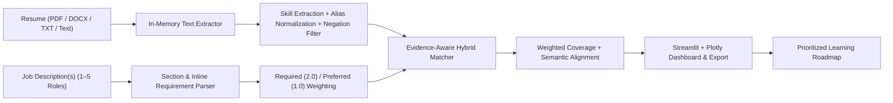

<div align="center">

# matchwise.

### Intelligent Resume–Job Matching & Explainable Skill Gap Analyzer

*Know where you stand. See what to build next.*

[](https://resume-job-matching-skill-gap-analyzer.streamlit.app/)
[](https://github.com/playlikeboy/resume-job-matching-skill-gap-analyzer/actions/workflows/backend-tests.yml)


[**Launch Live App**](https://resume-job-matching-skill-gap-analyzer.streamlit.app/) · [**Open 5th-Sem PPT**](https://view.officeapps.live.com/op/view.aspx?src=https%3A%2F%2Fraw.githubusercontent.com%2Fplaylikeboy%2Fresume-job-matching-skill-gap-analyzer%2Fmain%2Fdocs%2FMatchwise_5th_Sem_Presentation.pptx) · [**Read Easy → Advanced Guide**](docs/PROJECT_GUIDE.md) · [**Author Portfolio**](https://playlikeboy.github.io/)

</div>

---

> **Project status:** Functional prototype (`v0.2.0`) deployed live at **[resume-job-matching-skill-gap-analyzer.streamlit.app](https://resume-job-matching-skill-gap-analyzer.streamlit.app/)**. The deterministic matching pipeline, multi-role comparison engine, interactive Streamlit + Plotly dashboard, and synthetic starter benchmark (`B0` vs `B1` vs `H1`) are implemented; human-annotated evaluation remains governed by [`docs/EXPERIMENTAL_PROTOCOL.md`](docs/EXPERIMENTAL_PROTOCOL.md).

## What it does

- **Resume Ingestion (In-Memory):** Accepts pasted text or **PDF, DOCX, and TXT** uploads with zero server-side file storage, plus one-click sample resumes (**Alex Example** and [`examples/playlikeboy_resume.pdf`](examples/playlikeboy_resume.pdf) from [playlikeboy.github.io/resume](https://playlikeboy.github.io/resume)).
- **Explainable Skill Extraction:** Uses boundary-aware regex (`(?<![A-Za-z0-9])`), alias normalization (`JS` → `JavaScript`, `k8s` → `Kubernetes`, `postgres` → `PostgreSQL`), case/context guards (`Go`, `Express.js`), negation filtering (`no prior experience with ...`), and exact evidence quotes.
- **Weighted Requirement Parsing:** Detects **required (`2.0`)** vs **preferred (`1.0`)** skills from section headings and inline markers (`nice to have`, `bonus`, `preferred`).
- **Hybrid Scoring & Domain Breakdown:** Combines weighted coverage and semantic similarity (configurable `semantic_weight` from `0%` to `50%`) with domain-level coverage charts and extra detected skills.
- **Multi-Role Ranking & Roadmap:** Ranks up to **5 target job descriptions** side-by-side, prioritizes a **learning roadmap** (required gaps first) with project ideas, and exports **Markdown / JSON** reports.
- **5th-Semester Presentation & Guide:** Includes the full 14-slide BIT Mesra presentation ([`docs/Matchwise_5th_Sem_Presentation.pptx`](docs/Matchwise_5th_Sem_Presentation.pptx)) and beginner-to-advanced walkthrough ([`docs/PROJECT_GUIDE.md`](docs/PROJECT_GUIDE.md)).

## Research question

**Can a hybrid approach combining normalized skill extraction, weighted requirement coverage, and sentence-embedding similarity produce more useful and explainable resume-to-job alignment feedback than exact keyword matching alone?**

The score is a decision-support signal, not a hiring decision or verified proof of proficiency. Semantic similarity is a supporting signal only.

## How things work



1. **Text Extraction ([`extractors.py`](backend/app/services/extractors.py)):** Extracts selectable text from PDF (`PyMuPDF`), DOCX paragraphs/tables (`python-docx`), or TXT in memory; scanned/image PDFs are rejected with OCR guidance.
2. **Skill & Requirement Extraction ([`skill_extraction.py`](backend/app/services/skill_extraction.py), [`requirements.py`](backend/app/services/requirements.py)):** Normalizes 54 canonical skills across 12 domains (`SKILLS` in [`taxonomy.py`](backend/app/services/taxonomy.py)), captures exact evidence lines, and weights required (`2.0`) vs preferred (`1.0`) skills.
3. **Hybrid Matching ([`analysis.py`](backend/app/services/analysis.py), [`similarity.py`](backend/app/services/similarity.py)):**
   - **Strong (`1.0`):** Direct normalized skill evidence found in the resume.
   - **Partial (`0.5`):** Semantic similarity `>= 0.48` (`SEMANTIC_PARTIAL_THRESHOLD`) via `RELATED_SKILLS` / token overlap (`rule-based-fallback`) or optional `all-MiniLM-L6-v2` embeddings (`sentence-transformers`).
   - **Missing (`0.0`):** No direct or related evidence detected; feeds [`roadmap.py`](backend/app/services/roadmap.py) with required gaps prioritized first.
4. **Scoring Formula:**
   $$\text{Coverage} = 100 \times \frac{\sum (w_i \cdot m_i)}{\sum w_i}, \qquad \text{Overall} = (1 - \alpha)\cdot\text{Coverage} + \alpha\cdot\text{Semantic}$$
   where $\alpha \in [0.0, 0.5]$ (default `0.25`).

## Tech stack

| Layer | Technologies | Purpose |
|---|---|---|
| **Web UI & Charts** | `Streamlit 1.32+`, `Plotly` | Interactive dashboard, gauge, domain & multi-role charts, report/PPT downloads |
| **Core Engine** | `Python 3.11+`, `Pydantic` | Typed schemas, deterministic extraction, matching, scoring, and roadmap logic |
| **Document Parsing** | `PyMuPDF (fitz)`, `python-docx` | In-memory text extraction from PDF, DOCX, and TXT resumes |
| **NLP & Semantics** | Curated Taxonomy (54 skills), Boundary Regex, `Sentence Transformers` (optional) | Alias normalization, negation filtering, and `all-MiniLM-L6-v2` similarity |
| **Optional REST API** | `FastAPI`, `Uvicorn` | HTTP endpoints (`/api/analyze`, `/api/compare`, `/api/resume/parse`, `/api/taxonomy`) |
| **Testing & CI** | `pytest`, `Streamlit AppTest`, `GitHub Actions` | 22 automated unit, API, evaluation, and UI tests |

## Benchmark snapshot (`B0` vs `B1` vs `H1`)

Evaluated on [`examples/evaluation_dataset.jsonl`](examples/evaluation_dataset.jsonl) (6 synthetic starter pairs; full protocol in [`docs/EXPERIMENTAL_PROTOCOL.md`](docs/EXPERIMENTAL_PROTOCOL.md)):

| System | Mode | Skill F1 | Match Macro-F1 | Median Latency |
|---|---|---:|---:|---:|
| **B0** (Exact keyword baseline) | `exact-canonical` | `1.000` | `0.325` | `~0.4 ms` |
| **B1** (Weighted taxonomy + aliases) | `taxonomy-aliases` | `1.000` | `0.467` | `~1.4 ms` |
| **H1** (Hybrid pipeline) | `rule-based-fallback` | `1.000` | `0.918` | `~1.6 ms` |

## Quick start

### 1. Use the live deployed app

Open **[https://resume-job-matching-skill-gap-analyzer.streamlit.app/](https://resume-job-matching-skill-gap-analyzer.streamlit.app/)** — no local setup needed.

### 2. Run the Streamlit app locally

```bash
python3 -m venv .venv
# macOS / Linux
source .venv/bin/activate
# Windows PowerShell: .venv\Scripts\Activate.ps1
pip install -r requirements.txt
streamlit run streamlit_app.py
```

Open `http://localhost:8501` in your browser.

### 3. Optional FastAPI REST service

```bash
cd backend
pip install -r requirements.txt
uvicorn app.main:app --reload --port 8000
```

API docs: `http://localhost:8000/docs`.

### 4. Run tests & starter benchmark

```bash
cd backend
pytest -v
python scripts/evaluate.py
```

Or use the root [`Makefile`](Makefile) shortcuts (`make streamlit-run`, `make backend-test`, `make backend-eval`).

### 5. Enable embedding similarity (optional)

```bash
cd backend
pip install -r requirements-ml.txt
```

Set `USE_SENTENCE_TRANSFORMERS=true` before launching Streamlit (or in Streamlit Community Cloud **Secrets**). The first run downloads `sentence-transformers/all-MiniLM-L6-v2`.

## Deployment

- **Streamlit Community Cloud (Live):** Hosted at **[https://resume-job-matching-skill-gap-analyzer.streamlit.app/](https://resume-job-matching-skill-gap-analyzer.streamlit.app/)** using [`streamlit_app.py`](streamlit_app.py), [`requirements.txt`](requirements.txt), and [`.streamlit/config.toml`](.streamlit/config.toml).
- **Docker / Docker Compose:** Run `docker compose up --build` using [`docker-compose.yml`](docker-compose.yml) (Streamlit UI on port `8501`, optional FastAPI API on port `8000`), or build [`Dockerfile`](Dockerfile) directly.
- **Render Blueprint:** [`render.yaml`](render.yaml) configures both `matchwise-streamlit` and `matchwise-api`.

## Project structure

```text
streamlit_app.py                              Streamlit UI + Plotly visualizations + PPT & report export
requirements.txt                              Root Python dependencies for Streamlit Community Cloud
.streamlit/config.toml                        Dark navy & teal theme and server configuration
project-manifest.json                         Project metadata, live app URL, and stack manifest
Dockerfile                                    Container image for Streamlit app
backend/
  app/
    main.py                                   Optional FastAPI application and endpoints
    config.py                                 Centralized environment settings
    schemas.py                                Pydantic request/response contracts
    services/                                 Parsing, taxonomy, extraction, matching, roadmap
  scripts/
    evaluate.py                               B0 vs B1 vs H1 benchmark comparison script
  tests/                                      Pytest matching, evaluation, API, and Streamlit AppTest suites
docs/
  PROJECT_GUIDE.md                            Easy-to-advanced learning guide for the entire codebase
  Matchwise_5th_Sem_Presentation.pptx         14-slide 5th-semester project presentation (BIT Mesra)
  ARCHITECTURE.md                             Component & scoring architecture details
  EXPERIMENTAL_PROTOCOL.md                    B0 vs B1 vs H1 evaluation hygiene & rubric
  submission/                                 Original BIT Mesra report & presentation PDFs
examples/
  playlikeboy_resume.pdf                      Sample PDF resume from https://playlikeboy.github.io/resume
  sample_resume.txt                           Synthetic sample resume
  sample_job_description.txt                  Sample SWE Intern job description
  evaluation_dataset.jsonl                    Synthetic starter benchmark dataset
.github/workflows/                            CI workflow for backend & Streamlit tests
```

## Links & academic notes

- **Live App:** [https://resume-job-matching-skill-gap-analyzer.streamlit.app/](https://resume-job-matching-skill-gap-analyzer.streamlit.app/)
- **Author Portfolio:** [https://playlikeboy.github.io/](https://playlikeboy.github.io/)
- **Sample Resume Source:** [https://playlikeboy.github.io/resume](https://playlikeboy.github.io/resume)
- **5th-Sem Presentation:** [Open in Office Web Viewer](https://view.officeapps.live.com/op/view.aspx?src=https%3A%2F%2Fraw.githubusercontent.com%2Fplaylikeboy%2Fresume-job-matching-skill-gap-analyzer%2Fmain%2Fdocs%2FMatchwise_5th_Sem_Presentation.pptx) · [Download `.pptx`](docs/Matchwise_5th_Sem_Presentation.pptx)
- **Academic Submission Templates:** Stored in [`docs/submission/`](docs/submission/) (BIT Mesra 5-chapter / 30-page report guide and 12–15 slide presentation guideline).

## Current limitations

- Skill taxonomy is curated (54 skills across 12 domains) and scoped to entry-level software, backend, data, cloud/DevOps, and ML roles.
- Resume parsing is text-based; scanned/image PDFs need OCR and are rejected with guidance.
- Semantic similarity is optional and must be evaluated on annotated data rather than assumed to improve quality.
- Learning suggestions are rule-based prototypes, not personalized career guarantees.
- No authentication, permanent file storage, or multi-user history is included.

## License

No open-source license has been selected yet. Confirm ownership and the team's preferred license before distributing or adding a `LICENSE` file.
