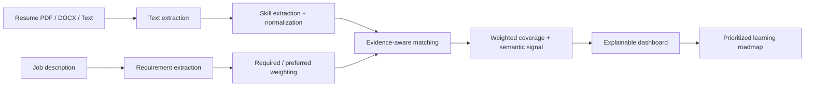

# Intelligent Resume–Job Matching & Explainable Skill Gap Analyzer

A research-oriented career-readiness web application that compares a candidate's resume with a job description, identifies demonstrated and missing skills, explains its score, and creates a prioritized learning roadmap.

> **Project status:** Initial implementation scaffold. The deterministic matching pipeline and API are implemented; embedding-based similarity is optional and must be evaluated against the baseline before reporting research claims.

## What it does

- Accepts resume text or PDF/DOCX uploads.
- Extracts technical skills and supporting evidence snippets.
- Identifies skills mentioned in a job description and distinguishes required from preferred requirements.
- Normalizes common aliases (for example, `JS` → `JavaScript`).
- Calculates a transparent weighted coverage score and a hybrid score.
- Labels requirements as **Strong match**, **Partial match**, or **Missing**.
- Produces actionable learning tasks and project ideas for skill gaps.

## Research question

**Can a hybrid approach combining normalized skill extraction, weighted requirement coverage, and sentence-embedding similarity produce more useful and explainable resume-to-job alignment feedback than exact keyword matching alone?**

The score is a decision-support signal, not a hiring decision or a verified measure of proficiency. Semantic similarity is supporting evidence only.

## Architecture



- **Frontend:** React + TypeScript + Vite
- **Backend:** Python + FastAPI
- **Resume parsing:** PyMuPDF and python-docx
- **NLP baseline:** curated taxonomy, alias normalization, and contextual extraction
- **Semantic experiment:** Sentence Transformers (optional dependency)
- **Testing:** pytest
- **Persistence:** intentionally deferred; PostgreSQL can be added after the analysis pipeline is stable

See [`docs/ARCHITECTURE.md`](docs/ARCHITECTURE.md) for component details and [`docs/PROJECT_PLAN.md`](docs/PROJECT_PLAN.md) for the semester roadmap.

## Quick start

### 1. Backend

```bash
cd backend
python -m venv .venv
# macOS / Linux
source .venv/bin/activate
# Windows PowerShell: .venv\Scripts\Activate.ps1
pip install -r requirements.txt
uvicorn app.main:app --reload --port 8000
```

API docs: http://localhost:8000/docs

### 2. Frontend

In a second terminal:

```bash
cd frontend
npm install
npm run dev
```

Open the local URL printed by Vite. The frontend expects the API at `http://localhost:8000` by default; set `VITE_API_BASE_URL` to override it.

### 3. Run tests

```bash
cd backend
pytest -q
```

### 4. Enable embedding similarity (optional)

```bash
cd backend
pip install -r requirements-ml.txt
```

Set `USE_SENTENCE_TRANSFORMERS=true` before starting the API. The first model run may download `sentence-transformers/all-MiniLM-L6-v2`. For an offline or lightweight demo, leave this disabled; the API clearly reports which semantic mode was used.

## Example API request

```bash
curl -X POST http://localhost:8000/api/analyze \
  -H 'Content-Type: application/json' \
  -d @../examples/sample_request.json
```

## Project structure

```text
backend/                  FastAPI application and matching engine
frontend/                 React + TypeScript user interface
docs/                     Research, architecture, project, report and presentation plans
docs/submission/           Three original BIT Mesra/project PDFs
examples/                 Example resume, job description and API request
.github/workflows/         Backend test workflow
```

## Evaluation plan

The project will compare at least two systems:

1. **Baseline:** exact keyword matching after basic normalization.
2. **Proposed hybrid:** normalized skill extraction + weighted coverage + semantic similarity.

Use manually annotated, consented or public examples; document dataset provenance; report precision, recall and F1 for skill detection, plus score agreement and qualitative explanation usefulness. Do not publish personal resumes or identifiable candidate data.

## Academic submission notes

The provided BIT Mesra report template and presentation guideline are stored in [`docs/submission/`](docs/submission/). The guide specifies a maximum of five report chapters and a body limit of 30 pages; the presentation guideline specifies 12–15 slides, including the title slide. Confirm the current batch-specific requirements and report-title wording with the project guide.

## Current limitations

- Skill taxonomy is curated and intentionally limited to entry-level software, backend, data and ML roles.
- Resume parsing is text-based; scanned PDFs need OCR and are out of initial scope.
- Semantic similarity is optional and must be tested, not assumed to improve quality.
- Learning suggestions are rule-based prototypes, not personalized career guarantees.
- No authentication, permanent file storage, or multi-user history is included in the first milestone.

## Team workflow

- Keep sample data synthetic or anonymized.
- Add tests for every matching-rule change.
- Record dataset versions, model versions, thresholds and experiment settings.
- Never commit real resumes, API keys, credentials or personal candidate information.

## License

No open-source license has been selected yet. Confirm ownership and the team's preferred license before making the repository public or adding a license file.
