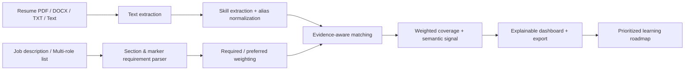

# Intelligent Resume–Job Matching & Explainable Skill Gap Analyzer

A research-oriented career-readiness web application (**matchwise.**) that compares a candidate's resume with one or more job descriptions, identifies demonstrated and missing skills with evidence snippets, explains its score, and generates a prioritized learning roadmap.

> **Project status:** Functional prototype (`v0.2.0`). The deterministic matching pipeline, multi-role comparison API, interactive React dashboard, and synthetic starter benchmark harness are implemented; real-world human-annotated evaluation (`B0` vs `B1` vs `H1`) remains governed by [`docs/EXPERIMENTAL_PROTOCOL.md`](docs/EXPERIMENTAL_PROTOCOL.md).

## What it does

- Accepts pasted resume text or **PDF, DOCX, and TXT** uploads (in-memory parsing, no server storage).
- Extracts technical skills with **boundary-aware regex**, **alias normalization** (e.g., `JS` → `JavaScript`, `k8s` → `Kubernetes`), **negation filtering**, and **supporting evidence snippets**.
- Parses job descriptions with **section-aware** and **inline marker** detection to weight **required (`2.0`)** vs **preferred (`1.0`)** skills.
- Computes a transparent **weighted coverage score**, **semantic similarity signal**, **domain category breakdown**, and **hybrid score** (configurable `semantic_weight` from `0%` to `50%`).
- Labels requirements as **Strong match**, **Partial match**, or **Missing**, and surfaces additional resume skills not listed in the job description.
- Compares and ranks up to **5 target job descriptions** against a single resume (`POST /api/compare`).
- Produces a prioritized **learning roadmap** (required gaps first) and supports **Markdown / JSON report export**.

## Research question

**Can a hybrid approach combining normalized skill extraction, weighted requirement coverage, and sentence-embedding similarity produce more useful and explainable resume-to-job alignment feedback than exact keyword matching alone?**

The score is a decision-support signal, not a hiring decision or a verified measure of proficiency. Semantic similarity is supporting evidence only.

## Architecture



- **Frontend:** React 18 + TypeScript + Vite
- **Backend:** Python 3.11 + FastAPI + Pydantic
- **Resume parsing:** PyMuPDF and python-docx (plus UTF-8/Latin-1 TXT)
- **NLP baseline:** curated taxonomy (50+ skills), alias normalization, negation filtering, and span-accurate contextual extraction
- **Semantic experiment:** Sentence Transformers (`all-MiniLM-L6-v2`, optional) with rule-based fallback
- **Testing & Evaluation:** `pytest` + reproducible comparison script (`backend/scripts/evaluate.py`)

See [`docs/ARCHITECTURE.md`](docs/ARCHITECTURE.md) for component details and [`docs/PROJECT_PLAN.md`](docs/PROJECT_PLAN.md) for the semester roadmap.

## Quick start

### 1. Backend

```bash
cd backend
python3 -m venv .venv
# macOS / Linux
source .venv/bin/activate
# Windows PowerShell: .venv\Scripts\Activate.ps1
pip install -r requirements.txt
uvicorn app.main:app --reload --port 8000
```

API docs: http://localhost:8000/docs

### 2. Frontend

In a second terminal:

```bash
cd frontend
npm install
npm run dev
```

Open the local URL printed by Vite. The frontend expects the API at `http://localhost:8000` by default; set `VITE_API_BASE_URL` to override it.

### 3. Run tests & starter benchmark

```bash
cd backend
pytest -v
python scripts/evaluate.py
```

Or use the root `Makefile` shortcuts (`make backend-test`, `make backend-eval`, `make frontend-build`).

### 4. Enable embedding similarity (optional)

```bash
cd backend
pip install -r requirements-ml.txt
```

Set `USE_SENTENCE_TRANSFORMERS=true` before starting the API. The first model run may download `sentence-transformers/all-MiniLM-L6-v2`. For an offline or lightweight demo, leave this disabled; the API clearly reports which semantic mode was used.

## Example API requests

Single resume–job analysis:

```bash
curl -X POST http://localhost:8000/api/analyze \
  -H 'Content-Type: application/json' \
  -d @examples/sample_request.json
```

Supported endpoints:
- `GET /api/health` — health check and active semantic mode
- `GET /api/taxonomy` — curated skill taxonomy grouped by domain
- `POST /api/resume/parse` — extract text from PDF, DOCX, or TXT uploads
- `POST /api/analyze` — single resume vs. job description analysis
- `POST /api/compare` — rank up to 5 job descriptions against one resume

## Project structure

```text
backend/
  app/
    main.py                 FastAPI application and endpoints
    config.py               Centralized environment settings
    schemas.py              Pydantic request/response contracts
    services/               Parsing, taxonomy, extraction, matching, roadmap
  scripts/
    evaluate.py             B0 vs B1 vs H1 benchmark comparison script
  tests/                    Pytest API, matching, and evaluation test suites
frontend/
  src/                      React + TypeScript dashboard, presets, and styles
docs/
  submission/               Original BIT Mesra report & presentation PDFs
examples/                   Sample resume, JD, API request, and synthetic eval JSONL
.github/workflows/          CI workflows for backend tests, frontend build, and Pages
```

## Deployment

- **GitHub Pages (Live Frontend Demo):** Automatically deployed via [`.github/workflows/deploy-pages.yml`](.github/workflows/deploy-pages.yml) to `https://playlikeboy.github.io/resume-job-matching-skill-gap-analyzer/`. When no FastAPI backend is connected, the UI seamlessly runs the browser-side fallback engine ([`localEngine.ts`](frontend/src/localEngine.ts)) for pasted text and `.txt` resumes.
- **Docker Compose (Full Stack):** Run `docker compose up --build` using [`docker-compose.yml`](docker-compose.yml) (Frontend on port `3000`, Backend API on port `8000`).
- **Render Blueprint:** [`render.yaml`](render.yaml) configures both the FastAPI Python web service and static React frontend for one-click deployment.

## Evaluation plan

The project compares three systems under [`docs/EXPERIMENTAL_PROTOCOL.md`](docs/EXPERIMENTAL_PROTOCOL.md):

1. **B0 (Baseline):** exact canonical keyword matching.
2. **B1 (Weighted taxonomy):** normalized aliases + required/preferred weights.
3. **H1 (Proposed hybrid):** B1 + evidence-aware matching + semantic similarity.

Use manually annotated, consented, or synthetic examples; document dataset provenance; report precision, recall, and F1 for skill detection, plus macro-F1, score agreement, and qualitative explanation usefulness. Do not publish personal resumes or identifiable candidate data.

## Academic submission notes

The provided BIT Mesra report template and presentation guideline are stored in [`docs/submission/`](docs/submission/). The guide specifies a maximum of five report chapters and a body limit of 30 pages; the presentation guideline specifies 12–15 slides, including the title slide. Confirm the current batch-specific requirements and report-title wording with the project guide.

## Current limitations

- Skill taxonomy is curated and intentionally scoped to entry-level software, backend, data, cloud/DevOps, and ML roles.
- Resume parsing is text-based; scanned/image PDFs need OCR and are rejected with guidance.
- Semantic similarity is optional and must be evaluated on annotated data rather than assumed to improve quality.
- Learning suggestions are rule-based prototypes, not personalized career guarantees.
- No authentication, permanent file storage, or multi-user history is included.

## License

No open-source license has been selected yet. Confirm ownership and the team's preferred license before distributing or adding a `LICENSE` file.
